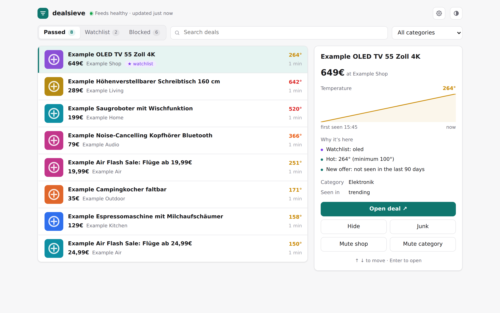
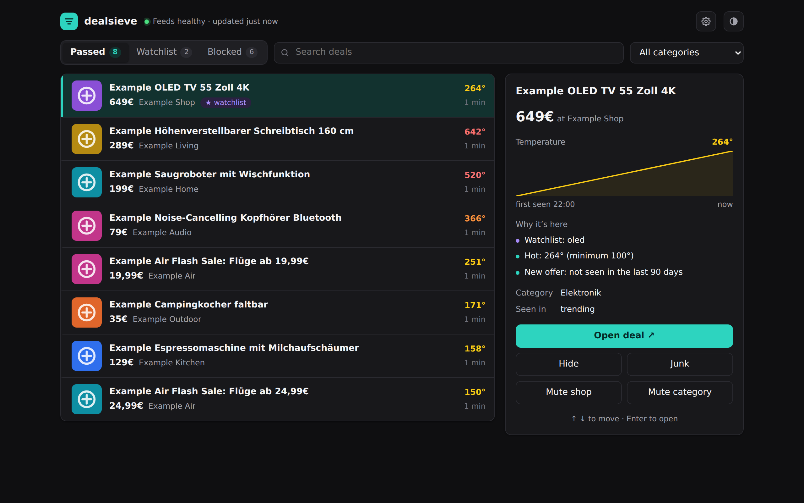
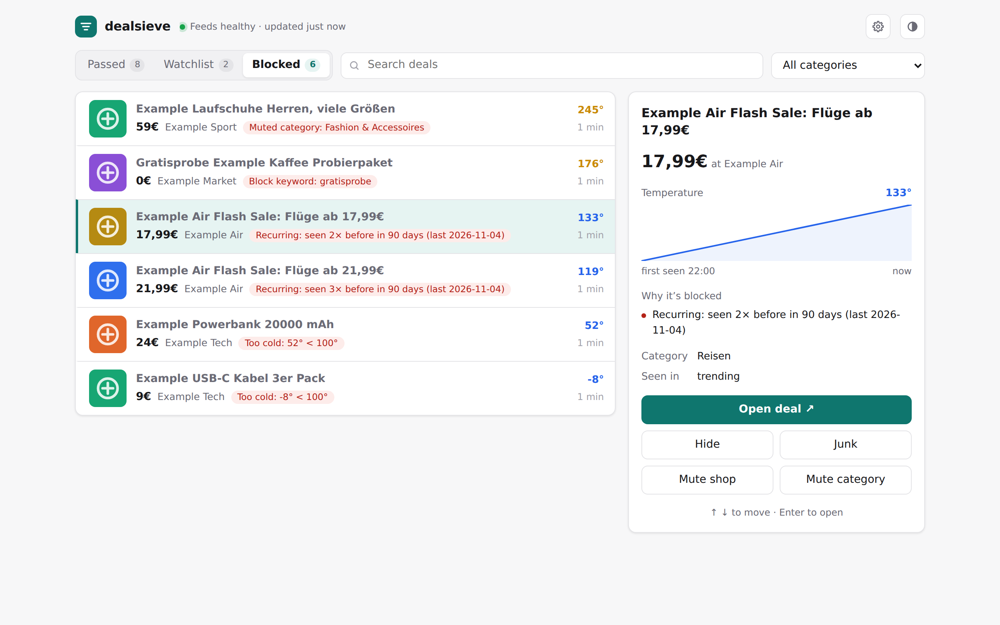
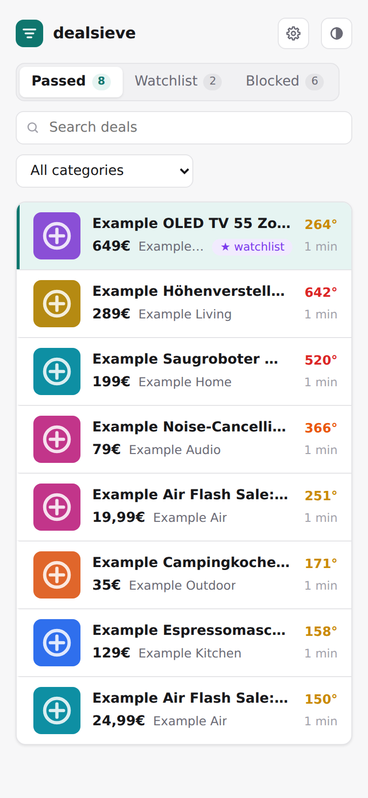
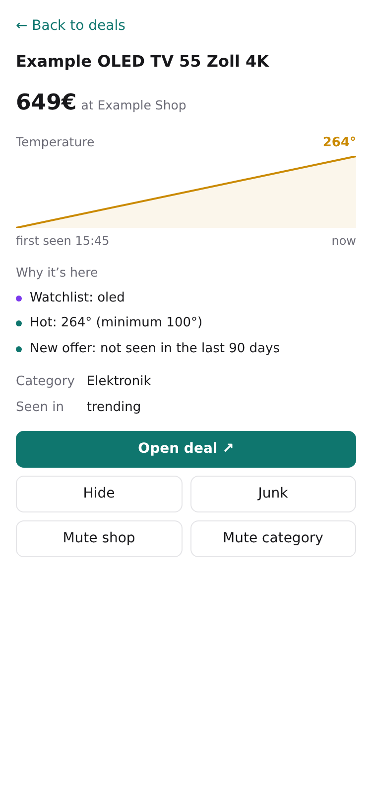

# dealsieve

[](https://codecov.io/gh/MorrisMorrison/dealsieve) [](https://morrismorrison.github.io/dealsieve/)

Documentation: <https://morrismorrison.github.io/dealsieve/>

A small, self-hosted filter for deal feeds. dealsieve reads a deal community's feeds, throws away
the noise, and shows what's left on a simple web page, with optional push notifications.

Its first source is [mydealz](https://www.mydealz.de); the other Pepper sites are optional extra sources. dealsieve is not affiliated with mydealz or the other Pepper sites; it reads
the public RSS feeds, links every deal back to the original post, and is meant for personal use.
Please respect the sites' terms and keep polling intervals reasonable.

## Sources

mydealz is on by default. The other Pepper-network sites with the same RSS format can be turned on
in Settings: hotukdeals, dealabs, preisjaeger, chollometro and pepper.pl. Each enabled site is polled
at the same intervals (trending every `DEALSIEVE_POLL_TRENDING`, new deals every
`DEALSIEVE_POLL_NEW`). Rules, mutes and the watchlist apply across sources; recurrence counts only
deals from the same source, and each source can have its own minimum temperature. Prices are shown
as the feed gives them (£, €, zł), with no conversion.

## Screenshots

<!-- Generated from made-up demo data by the "README screenshots" workflow
     (.github/workflows/screenshots.yml, capture script in screenshots/) and published
     to the `screenshots` branch on every relevant push to main. Do not edit by hand. -->

<table align="center">
  <tr>
    <td align="center"><br /><sub>Inbox, light</sub></td>
    <td align="center"><br /><sub>Inbox, dark</sub></td>
  </tr>
  <tr>
    <td align="center"><br /><sub>Blocked, with the reason why</sub></td>
    <td align="center"> <br /><sub>On a phone</sub></td>
  </tr>
</table>

## What it filters

- **Recurring pseudo-deals.** The same kind of offer posted again and again ("flights from €19.99")
  is recognized by a fingerprint of merchant + title words and blocked after it has been seen a
  few times.
- **Categories, merchants and keywords** you never want to see.
- **Cold deals** below a temperature you choose (per category if you like).
- **Your own feedback:** every deal's detail panel has *Hide*, *Junk*, *Mute shop* and
  *Mute category*. *Junk* blocks everything that looks like that deal from then on. *Hide* and
  *Junk* can be undone right on the deal; mutes become entries in your settings.
- **Suggestions:** when you keep hiding or junking deals from one shop or category, the Settings
  page suggests muting it, with the examples that led to it. Apply or dismiss.

All of this is edited on the **Settings** page (the gear in the header), applies without a restart,
and every save is kept as a version you can undo.

The page is an inbox: a list of deals on the left and the selected deal on the right, with its
heat curve and why it's there (or why it's blocked). Blocked deals stay visible in their own tab,
so you can see whether a rule is too strict. Use ↑/↓ to move through the list and Enter to open a
deal; on a phone, a deal opens as a full-screen sheet.

## Watchlist and notifications

Watchlist keywords are checked against every new deal as soon as it's posted, before it trends.
Channels and notification rules are set on the Settings page (with a *Send test* button); tokens
stay in environment variables. Notification rules send watchlist hits, or deals above a temperature, to
[ntfy](https://ntfy.sh) and/or Telegram. An optional daily digest (off by default) sends one message a day
with your watchlist hits and the top new deals; it has its own block on the Settings page.

## Run it

```bash
docker run -d --name dealsieve -p 8080:8080 \
  -v dealsieve-data:/data \
  ghcr.io/morrismorrison/dealsieve:latest
```

Open the page and configure everything under **Settings** (the gear). The page has **no login**:
keep it on a private network or put it behind your reverse proxy's authentication.

**Upgrading from v0.0.1?** Breaking change: `config.yaml` (and `DEALSIEVE_CONFIG`) is no longer
read. Remove the mount and re-enter your settings on the Settings page.

With a bind mount instead of a named volume for `/data`, make the directory writable by UID 65532.

**Image tags.** `:latest` follows `main` (every merged change). To stay on a release instead, pin its
version, e.g. `ghcr.io/morrismorrison/dealsieve:0.0.1`; see the
[releases page](https://github.com/MorrisMorrison/dealsieve/releases). dealsieve is pre-1.0: releases
are snapshots on the way to a stable 1.0, not long-term-supported versions.

## Configuration

| Env var | Default | |
|---|---|---|
| `DEALSIEVE_DATA_DIR` | `./data` (`/data` in the image) | Where the SQLite database lives |
| `DEALSIEVE_LISTEN` | `:8080` | Listen address |
| `DEALSIEVE_LOG_FORMAT` | `text` | `text` or `json` |
| `DEALSIEVE_POLL_TRENDING` | `5m` | Interval for the trending feed (minimum `1m`) |
| `DEALSIEVE_POLL_NEW` | `2m` | Interval for the feed of every new deal (minimum `1m`) |
| `DEALSIEVE_TELEGRAM_TOKEN` | | Bot token, needed for Telegram channels |
| `DEALSIEVE_NTFY_TOKEN` | | Access token for a protected ntfy server |
| `DEALSIEVE_MYDEALZ_URL` | `https://www.mydealz.de` | Feed host (for tests or a mirror) |
| `DEALSIEVE_HOTUKDEALS_URL` | `https://www.hotukdeals.com` | Feed host (for tests or a mirror) |
| `DEALSIEVE_DEALABS_URL` | `https://www.dealabs.com` | Feed host (for tests or a mirror) |
| `DEALSIEVE_PREISJAEGER_URL` | `https://www.preisjaeger.at` | Feed host (for tests or a mirror) |
| `DEALSIEVE_CHOLLOMETRO_URL` | `https://www.chollometro.com` | Feed host (for tests or a mirror) |
| `DEALSIEVE_PEPPERPL_URL` | `https://www.pepper.pl` | Feed host (for tests or a mirror) |
| `DEALSIEVE_PUBLIC_URL` | unset | The address you open dealsieve at, e.g. `https://deals.example.com`. The daily digest links to it. |

Environment variables are for infrastructure and secrets and apply on restart; invalid values are
rejected at startup with a list of problems. Everything else (watchlist, mutes, keywords,
temperatures, recurrence, notification channels and rules) lives on the Settings page.

**Security.** The page has no login of its own. `DEALSIEVE_NTFY_TOKEN` is sent to the server of every
ntfy channel (and by Send test), so anyone who can reach the page can point a channel at a server of
their own and receive it. Keep dealsieve on a private network or behind an authenticating proxy, and use
an ntfy token scoped to the dealsieve topic.

## Development

```bash
go test ./...
go test -tags e2e ./test/e2e/
node --test web/static/js/*.test.js
```

The frontend is plain HTML, CSS and ES modules embedded into the binary: no build step.

## License

MIT
